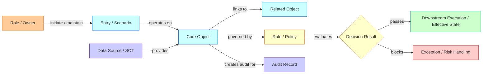
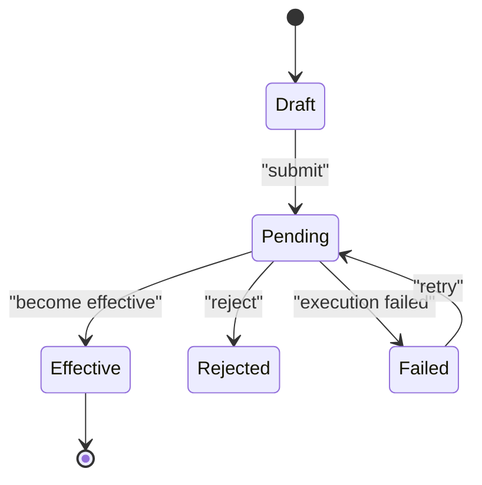
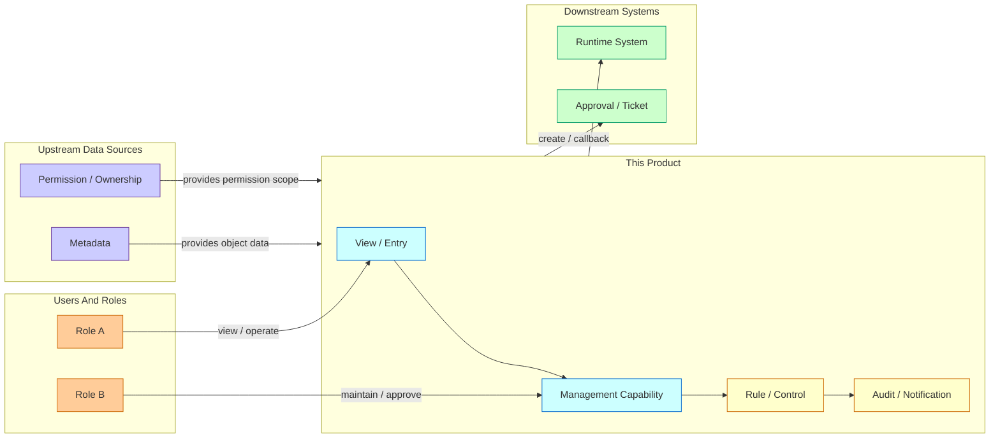
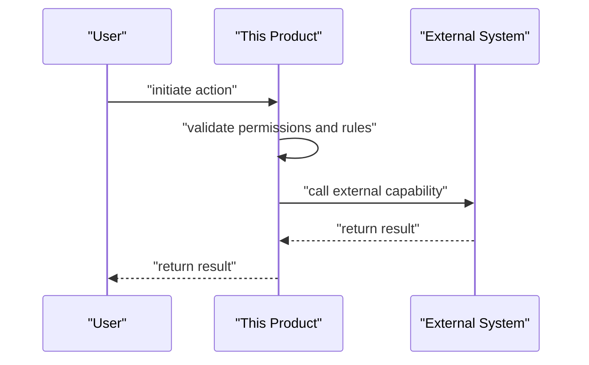

# PRD Template

Use this as an adaptable template for a new full PRD. Preserve an existing document's useful outline for scoped revisions. Cover the applicable problem, scenarios, model, rules, permissions, dependencies, and acceptance questions; completeness is not a fixed heading count. Explain material non-applicability rather than inventing facts to fill rows. Use the user's language and established style.

This is a bank of coverage prompts, not a required published outline. For a PRD that explains use and development, start with the necessary background, users/stories, model, and page solution; add other sections only when they answer a real question. Keep internal reasoning, coverage matrices, and tool checks out of the canonical body. Reuse the three-column product-solution form when it matches the user's document, with actual prototypes aligned to their modules.

- Apply the required `humanizer` skill before each writing, revision, or diagram pass, including headings, table copy, captions, and diagram labels. Preserve facts and product rules.
- Organize body content in short points. Use two-level lists for grouped rules, ordered lists for steps, and tables for comparisons; keep brief context as prose.

Expression rule: use diagrams for relationships/flows, tables for repeated rules and executable items, charts for quantitative patterns, and concise prose for judgment. Prefer the target's native editable form where supported. Mermaid examples below apply when Mermaid suits the host; replace example nouns and remove irrelevant branches. Verify rendering and keep styling consistent.

Depth rule: a full PRD must explain the relevant domain behavior rather than stop at generic CRUD bullets. Do the first-principles reasoning internally; publish the conclusions and tradeoffs needed by readers. Specify fields, operations, states, permissions, and exceptions where they affect the product, without turning every checklist item into a chapter or milestone.

## 0. Document Information

| Field | Content |
| --- | --- |
| Title |  |
| Status | Draft / Review / Ready / Deprecated |
| Version |  |
| PM |  |
| Sponsor |  |
| Owner |  |
| RD / FE / QA / Design / Ops |  |
| Related docs |  |

## 1. Demand Reflection And First-Principles Interpretation (Working Notes When Appropriate)

### User Request

Describe the actual work goal, actor, cadence, scale, and pain. Record a proposed UI/workflow separately from the underlying need. Distinguish original quotes, source facts, synthesized needs, review feedback, and assistant proposals.

### Reflection

| Item | Content |
| --- | --- |
| Surface request |  |
| Surface symptom |  |
| First-principles problem |  |
| Human driver |  |
| Real constraints |  |
| Inherited assumptions to challenge |  |
| Simpler / more universal alternatives |  |
| Chosen conclusion |  |

### Solution Path Judgment

| Candidate Path | Level | Why It May Work | Why It May Fail | Decision |
| --- | --- | --- | --- | --- |
| Requested implementation | Feature / UI / Workflow |  |  | Accept / Transform / Reject |
| Model-level solution | Concept / Entity / Ownership |  |  |  |
| Rule-level solution | Default / Validation / Permission / Policy |  |  |  |
| Data/process solution | Data correction / Integration / Ops agreement |  |  |  |

## 2. Background And Problem Definition

### Background

Describe the business, system, operational, or incident context.

### Current Situation

Describe current process, current system, current workaround, and who is involved.

### Core Problems

| Problem | Root Cause | Impact | Evidence / Metric |
| --- | --- | --- | --- |
|  |  |  |  |

### Scope

This PRD solves:

- 

Adjacent responsibilities and deferred scope:

- 

## 3. Goals And Success Metrics

### Metric Definition

| Metric / Decision | Business Object / Unit | Source | Population / Filters | Time / Version | Formula / Deduplication / Precision | Update / Drill-down |
|---|---|---|---|---|---|---|
|  |  |  |  |  |  |  |

Distinguish planned, actual, cumulative, and current-state quantities. Write named-field formulas for business readers. Keep comparison population, visible subset, and modification set explicit. Use complete, consistent representative examples and identify illustrative values in the review context.

| Goal Type | Goal | Metric / Verification |
| --- | --- | --- |
| User |  |  |
| System |  |  |
| Business |  |  |
| Delivery |  |  |

## 4. Concepts And Glossary

| Concept | Definition | Example | Boundary / Distinction |
| --- | --- | --- | --- |
|  |  |  |  |

## 5. User Roles And Scenarios

| Role | Work / Cadence / Scale | Pain / Decision | Desired Outcome | Authority / Scope | Evidence / Source Status |
|---|---|---|---|---|---|
|  |  |  |  |  |  |

Role count follows current responsibilities. Role merges must reconcile stories, permissions, approvals, and notification recipients. Keep prototype-review choices and writing instructions in the solution/review context, rather than treating them as role needs.

| Role | Scenario | I want to | So that | Function | Acceptance |
| --- | --- | --- | --- | --- | --- |
|  |  |  |  |  |  |

## 6. Product Positioning And System Boundary

### Positioning

Describe what this product/module is in the whole system.

### System Responsibilities

| System | Team | Responsibility | Change In This PRD |
| --- | --- | --- | --- |
|  |  |  |  |

### Boundary

This product owns:

- 

This product reuses:

- 

This product only references:

- 

## 7. Domain Model And Key Rules

### Concept Relationship Diagram

Explain the core nouns and relationships before listing fields. Keep the diagram focused on one question. Include the relevant actor, objects, cardinality, ownership, and source relationships. Node count is not a quality criterion; control, audit, and exception elements belong only when they answer this diagram's question.

### Entities

| Entity | Description | Unique ID | Owner | Source Of Truth |
| --- | --- | --- | --- | --- |
|  |  |  |  |  |

### Entity Fields

| Entity | Field | Meaning | Type | Required | Default | Validation | Notes |
| --- | --- | --- | --- | --- | --- | --- | --- |
|  |  |  |  |  |  |  |  |

### Relationships

| Source Entity | Relationship | Target Entity | Cardinality | Notes |
| --- | --- | --- | --- | --- |
|  |  |  |  |  |

### State Machine

| Current State | Action | Next State | Actor | Validation | User Feedback |
| --- | --- | --- | --- | --- | --- |
|  |  |  |  |  |  |

### Key Rules

- 

## 8. Product Solution Overview

### System Boundary / Layered Architecture

Use this diagram to show ownership and dependency boundaries, not every implementation detail.

### Information Architecture

Describe modules, navigation, and entry points.

### Core Flow

Describe the main user flow and system flow. Prefer a sequence diagram or flowchart over prose when order, branching, or responsibility matters.

Diagram Quick Read:
- Purpose: explain the responsibility chain from user initiation to system feedback.
- Main path: after the user submits an action, this product validates permissions and rules, calls the external capability, and returns the result.
- Key branches: validation failure should block the action and explain the reason; external system failure should enter retry, rollback, or manual handling.
- Responsibility boundary: this product owns validation, orchestration, and user feedback; the external system owns the execution result of the called capability.

### Solution Tradeoffs

| Solution | Description | Pros | Cons | Risks | Conclusion |
| --- | --- | --- | --- | --- | --- |
|  |  |  |  |  |  |

## 9. Detailed Module Design

Repeat this section for each module.

### Module: [Name]

#### Positioning

What this module solves and who uses it.

#### Entry

Where users enter from, and what context is carried.

#### Page / Layout

Describe the decision and visible groups: object/status, next action, static evidence, impact comparison, and records as applicable. Align same-group fields, separate action guidance from data, and keep status/actions close to their object. Choose charts or tables by information task.

#### Data Display Contract

| Area | Field / Content | Source | Sort / Filter | Empty / Error Behavior | Permission |
| --- | --- | --- | --- | --- | --- |
|  |  |  |  |  |  |

#### Fields

| Field | Meaning | Type | Source | Required | Default | Validation | Permission / State | Notes |
| --- | --- | --- | --- | --- | --- | --- | --- | --- |
|  |  |  |  |  |  |  |  |  |

#### Operations

| Operation | Entry | Preconditions | Flow | Success Feedback | Failure Feedback | Audit | Permission |
| --- | --- | --- | --- | --- | --- | --- | --- |
|  |  |  |  |  |  |  |  |

#### Operation Rules

| Rule | Trigger | System Judgment | User Feedback | Audit / Notification |
| --- | --- | --- | --- | --- |
|  |  |  |  |  |

#### Batch Contract (When Applicable)

| Actor / Cadence / Scale | Input / Object | Full-Batch Validation | Correction / Preview | Execution Scope / Strategy | Idempotency / Result / Return |
|---|---|---|---|---|---|
|  |  |  |  |  |  |

Clarify pagination, cross-row constraints, duplicate handling, and whole/partial execution policy. Confirmation depends on consequence, not the batch label. Match input throughput to actual workload; preserve withdrawn scope.

#### States And Exceptions

The rows below are coverage prompts, not a prescribed state enum. Use justified business states/errors, and put unknown business decisions in the consolidated decision table.

| State / Exception | Trigger | UI Behavior | System Behavior | Notes |
| --- | --- | --- | --- | --- |
| Empty |  |  |  |  |
| Loading |  |  |  |  |
| No permission |  |  |  |  |
| Validation failed |  |  |  |  |
| Dependency unavailable |  |  |  |  |

## 10. Permissions, Audit, Data, And Dependencies

### Permission Matrix

| Role | Operation / State | Object / Data Scope | Approval / Prerequisite | No-Permission Behavior | Audit |
|---|---|---|---|---|---|
|  |  |  |  |  |  |

Use confirmed project roles and responsibilities; do not assume a fixed number of roles or grant missing permissions from the template.

### Audit

Audit must record:

- Actor
- Time
- Object
- Operation type
- Before value
- After value
- Reason
- Related ticket / task / rule

### Data And Interfaces

| Data / Interface | Provider | Consumer | Sync Method | Consistency Requirement | Fallback |
| --- | --- | --- | --- | --- | --- |
|  |  |  |  |  |  |

## 11. Milestones And Priority

### Priority

| Priority | Function | Reason | Dependency |
| --- | --- | --- | --- |
| P0 |  |  |  |
| P1 |  |  |  |
| P2 |  |  |  |

### Milestones

| Iteration | Priority | Main Functions | User Outcome |
|---|---|---|---|
|  |  |  |  |

Use the requested iteration count and group the main functions by usable capability. Each iteration needs a few concrete user actions and a direct outcome, not a copy of every field, state, permission, and exception. Check feature coverage internally. P0 must support the core work independently; later capabilities enhance it when their dependency allows.

For a requested execution schedule, add grounded dates, owners, real dependencies, and exit conditions in a separate detailed plan. Schedule independent work in parallel; constrain specific integration nodes rather than serializing every stream. Dates without estimates remain proposals. A Roadmap, if needed, must agree with the schedule.

## 12. Risks And Open Decisions

| Item / Type | Available Evidence | Missing Decision / Risk | Impact | Owner / Next Step | Deadline / Status |
|---|---|---|---|---|---|
|  |  |  |  |  |  |

## 13. Acceptance Criteria (When Requested Or Needed)

Use a separate table when it helps implementation or release decisions. Otherwise keep observable outcomes in the product rules and use the review checklist internally; avoid adding a generic validation chapter to prove the document is complete.

| Scenario | Preconditions | Operation | Expected Result | Verification |
| --- | --- | --- | --- | --- |
|  |  |  |  |  |

Use the current document's native structure for updates. Verify target prose, related diagrams/prototypes, styles/links, data arithmetic, and affected acceptance rules. Report proposal, document update, static review, runtime evidence, and acceptance separately.
